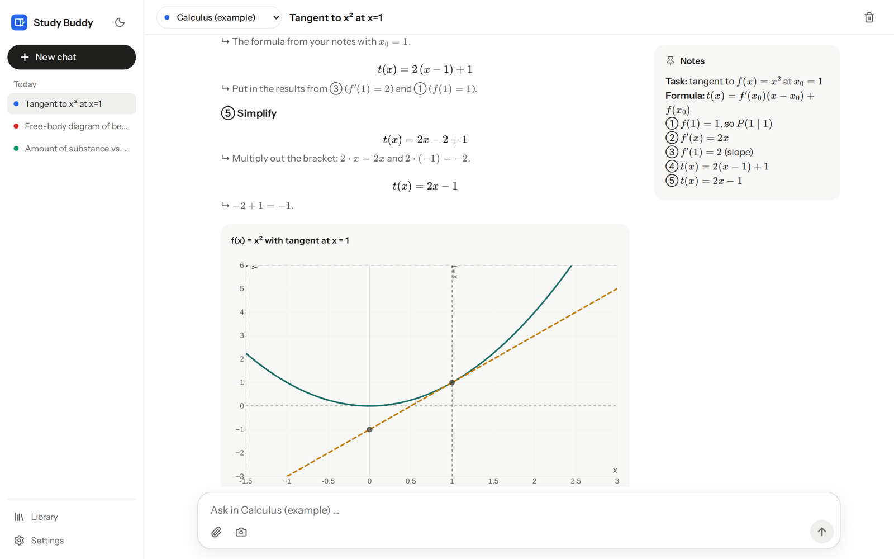
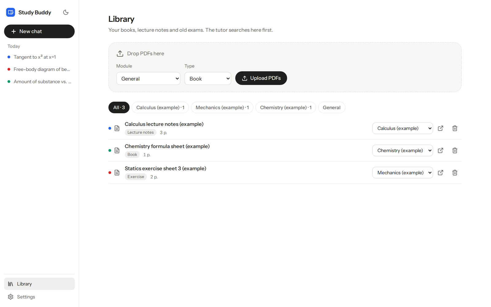
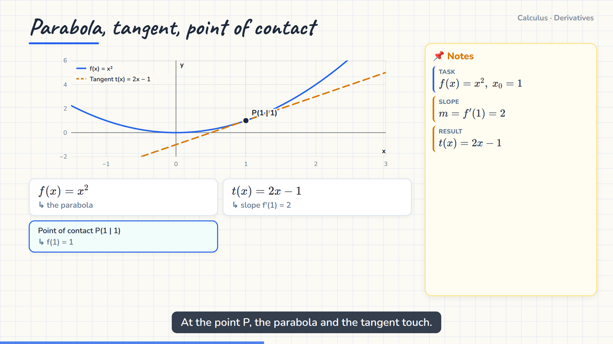
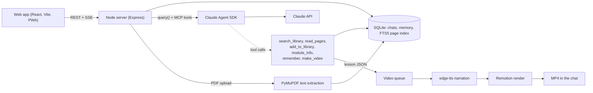

# Study Buddy

A personal study tutor built for a real student: my wife's engineering studies. She uses it every day.
You ask a question (or send a photo of an exercise or a PDF), and Study Buddy answers from your own
course material, step by step, with formulas, graphs and sketches. On request, it turns the explanation
into a narrated explainer video.

**UI in English, German and Arabic.** The tutor answers in the language you pick. A fresh clone starts in English.

<p>
  
</p>

| Library | Explainer video (rendered frame) |
|---|---|
|  |  |

*All screenshots use demo data: example modules and made-up PDFs.*

## What it does

- **Chat tutor with tools.** Claude (via the Claude Agent SDK) runs with a small set of in-process tools:
  - `search_library`: full-text search over your PDFs
  - `read_pages`: read the extracted text of specific pages, or open a page as an image for formulas and figures
  - `add_to_library`: keep a PDF from the chat for later
  - `module_info`: the course description of a module
  - `remember`: durable notes about the learner
  - `make_video`: write a video lesson and queue it for rendering
- **Explains slowly.**
  - The tutor rules ask for the basics first, then one transformation per line with a "↳ why" note under each line.
  - A pinned *Merkzettel* (running notes) keeps the task and every intermediate result in view.
  - Graphs (`function-plot`), diagrams (Mermaid) and sketches (sanitised SVG) are drawn right inside the answers.
- **PDF library.**
  - PDFs are split into pages with PyMuPDF and indexed in SQLite FTS5 (BM25 ranking, accent-insensitive).
  - Answers cite the document and page.
- **Explainer videos.** Lesson JSON → edge-tts narration with word timestamps → Remotion render:
  - Formulas, step lists and karaoke-style captions.
  - Function graphs that draw in sync with the voice.
  - Sketches whose parts appear one after another.
- **Installable web app (PWA).**
  - Works on iPad and Android; designed for tablet and phone first.
  - Light and dark mode.
  - The service worker caches only the app shell, never API responses.
- **Three languages.** The UI comes in English, German and Arabic (with right-to-left layout), and the tutor answers in the selected language. Optionally, technical terms can be added in brackets in a second language, for example when the exams are in German.
- **Password login** with a signed HttpOnly cookie and rate limiting: 5 failed attempts per IP per 15 minutes, 30 in total.

## Architecture



**How a question flows through the system**

1. **Send.** The browser posts the question and any attachments (photos are downscaled on the device first).
2. **Run.** The server starts a Claude Agent SDK `query()` for this chat, resuming the chat's session.
   - The system prompt holds the tutor rules, the learner's profile and memory, and a summary of the library.
   - The tools are exposed as an in-process MCP server.
3. **Look things up.** Claude usually searches the library first (`search_library`), then reads the matching pages (`read_pages`). For formulas and figures it opens the PDF page itself with the read-only `Read` tool, which is restricted to the data folder.
4. **Stream.** The answer streams back to the browser over Server-Sent Events. If the iPad goes to sleep, the turn keeps running on the server and the client reconnects.
5. **Render in the browser.** The browser renders Markdown, KaTeX, the coloured blocks, the running notes and the graphs.
6. **Video (on request).** If you ask for a video, Claude writes a lesson with `make_video`. The server validates it with zod, voices it with edge-tts and renders it with Remotion, one video at a time. The finished MP4 appears in the chat.

## Repository layout

```
app/
  server/      Node server: API, auth, Claude agent and tools, library, video queue
  web/         React UI (Vite), service worker, manifest
  scripts/     extract_pdf.py (PyMuPDF)
  config/      app.example.json, modules.example.json, student.example.md (copy and edit)
video/
  src/         Remotion composition: scenes, graphs, sketches, captions
  lessons/     demo lessons: tangent-en (English) and three German ones
  scripts/     tts.py (edge-tts), demo.mjs
library/       drop your own PDFs here, one folder per module id
docs/          screenshots
```

## Setup

**Tested with** Node.js 24.22 (needs ≥ 23.6 for built-in TypeScript type stripping and `node:sqlite`), Python 3.12,
ffmpeg 6.1, Remotion 4.0.540 and `@anthropic-ai/claude-agent-sdk` 0.3.318. It runs on Linux and macOS.
Remotion downloads its own headless Chrome on the first render.

```bash
git clone https://github.com/yovsefx/study-buddy.git
cd study-buddy

# Python tools (PDF text extraction, text-to-speech)
python3 -m venv .venv
.venv/bin/pip install -r requirements.txt

# Web app and server
cd app
npm install
cp .env.example .env            # then fill in the values, see below
npm run build                   # builds the web UI into app/dist
npm start                       # serves on http://127.0.0.1:3000 (PORT in .env)

# Video renderer (only needed for explainer videos)
cd ../video
npm install
npm run demo -- lessons/tangent-en.json   # optional: voice and render a demo to video/out/
```

### Configuration

- **`app/.env`**, copied from `app/.env.example`:
  - `ANTHROPIC_API_KEY`: an API key from the [Claude Console](https://platform.claude.com/). This is the authentication the [Agent SDK docs](https://code.claude.com/docs/en/agent-sdk/quickstart) recommend. The SDK reads it from the process environment; `npm start` loads `.env` for you.
  - `STUDY_PASSWORD`: the login password. Use a long random one.
  - `STUDY_SECRET`: the key for signing the login cookie.
  - `PORT`, plus the optional `STUDY_MODEL`, `BASE_PATH`, `DATA_DIR`, `CONFIG_DIR`, `LIBRARY_DIR` and `PYTHON`.
- **`app/config/app.json`**: the starting language (`"lang": "en" | "de" | "ar"`) and `termLanguage` (for example `"Deutsch"` to add German technical terms in brackets, or `null`). Copy `app.example.json`. You can switch the language later in Settings.
- **`app/config/modules.json`**: your subjects. Copy `modules.example.json`.
  - Each module has an `id`, a `name`, an `icon` (a [Lucide](https://lucide.dev/icons) name such as `sigma`), a `color` and optional `handbook` text (the course description the tutor can look up).
  - Keep the `allgemein` (general) module.
- **`app/config/student.md`**: one or two sentences about the learner, for example what and where they study, and their first language. Copy `student.example.md`.
- **Your PDFs:** put them in `library/<module-id>/`. They are imported on start, or you can upload them in the app.

Without your own config files, the app runs with the example files, in English.

### Running it for real

The server listens on `127.0.0.1` only. To reach it from your phone, put a reverse proxy (Caddy, nginx) or a
tunnel (for example Cloudflare Tunnel) in front of it with HTTPS. `trust proxy` is limited to loopback,
so the login rate limit sees real client IPs and can't be dodged with a faked `X-Forwarded-For` header.
Install the app from the browser: Safari → Share → Add to Home Screen, or Chrome → Install app.

## Limitations

- **Claude is the only model provider.** The agent loop, tools and file reading rely on the Claude Agent SDK.
- **One user at a time.** There is a single password and no accounts. Everyone who logs in sees the same chats and library.
- **Some parts are German-only.**
  - **The tutor's rules and system prompt** are written in German. The answers still come in the language you pick, because the prompt tells the tutor which language to use.
  - **App-generated videos** are narrated by a German voice (edge-tts "Conrad"), and their on-screen labels are German. The video engine itself supports any edge-tts voice and English labels: the `tangent-en` demo uses both.
- **edge-tts** uses an unofficial Microsoft endpoint. It is free and sounds good, but it can change or stop working without notice.
- **Text-only search.** Scanned PDFs (pages without a text layer) are not full-text searchable. The tutor can still open those pages as images.
- **Your content leaves the machine.** Questions, attachments and the library pages the tutor reads are sent to the Claude API.

## Roadmap ideas

Pull requests and forks for non-commercial use are welcome. Good next steps:

- **Multi-user accounts:** per-user chats, libraries and memory, instead of one shared password.
- **Other model providers:** an adapter around the tool layer, for OpenAI-compatible APIs or local models.
- **English tutor rules and narration:** an English version of the tutor rules, and videos narrated in the UI language (the voice and the labels are already per-lesson settings in the video engine).
- **Other subjects and universities:** a setup wizard for modules and course descriptions.
- **Docker:** one image with Node, Python, ffmpeg and Chrome for the renderer.
- **Tests and CI:** unit tests for the lesson validator and the search, Playwright smoke tests, GitHub Actions.
- **A deploy guide:** a reverse proxy or tunnel, HTTPS, and backups of the data folder.
- **Pluggable TTS:** swap edge-tts for Azure Speech, ElevenLabs or a local engine such as Piper.

## License

Source-available for **non-commercial use only**, under the [PolyForm Noncommercial License 1.0.0](LICENSE).
You may use, modify and share it for personal, educational, research and other non-commercial purposes.
Commercial use needs separate permission.

## Credits

Designed and built by Youssef Eldeeb with AI coding agents.

Built on [Claude Agent SDK](https://code.claude.com/docs/en/agent-sdk/overview),
[Remotion](https://www.remotion.dev/) (check its [license](https://www.remotion.dev/docs/license) for team use),
[PyMuPDF](https://pymupdf.readthedocs.io/), [edge-tts](https://github.com/rany2/edge-tts),
[KaTeX](https://katex.org/), [function-plot](https://mauriciopoppe.github.io/function-plot/),
[Mermaid](https://mermaid.js.org/), [DOMPurify](https://github.com/cure53/DOMPurify) and [Lucide](https://lucide.dev/).
